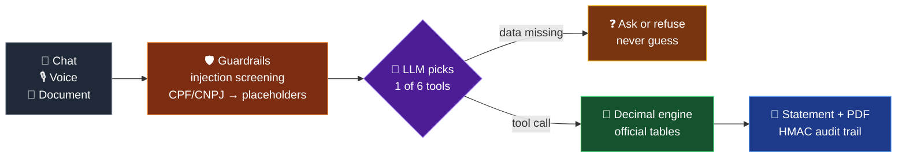

<div align="center">

# 👋 Hi, I'm Matheus Assis

**Software Engineer (AI / Backend) | Safe LLM agents for finance & personal data**

*I solve problems the way a business owner would — with strategic vision, accountability, and a drive for real impact.*

<picture>
  <source media="(prefers-color-scheme: dark)" srcset="https://readme-typing-svg.demolab.com?font=Fira+Code&weight=500&size=20&duration=3200&pause=1400&color=58A6FF&center=true&vCenter=true&width=640&height=44&lines=Software+Engineer+%28AI+%2F+Backend%29;I+build+AI+agents+you+can+trust+with+money;The+LLM+decides.+Deterministic+code+does+the+math.;1%2C000%2B+automated+tests+%C2%B7+public+code">
  
</picture>

[](https://linkedin.com/in/assismatheus)
[](mailto:matheus.assis51@gmail.com)
[](https://github.com/matheusStark25)


</div>

---

### 🧭 About Me

- 🔭 I'm a **Software Engineer (AI / Backend)**, building LLM agents that are safe to trust with money and personal data
- 🧠 I approach every challenge with a **business-owner mindset** — I don't just write code, I solve the *right* problems
- 🤖 Specialized in **AI agents, LLM tool calling, multi-agent architectures and RPA with a human in the loop**
- 🌍 Based in **Ipuiúna, MG, Brazil (UTC-3)** — open to **remote opportunities worldwide** and **relocation**
- 🎓 B.S. in Information Systems at Anhanguera Educacional (2024–2027)
- 📜 [AWS Academy Graduate – Generative AI Foundations](https://www.credly.com/badges/311d10f3-dbf3-4368-9633-f3136589656e) (2026)
- 💬 Languages: **Portuguese** (Native) · **English** (Professional working proficiency)
- ⚡ Fun fact: I came from logistics, and in 2026 I built, solo, a payroll AI where being **50 cents off counts as a bug**

---

### 🛠️ Tech Stack

<div align="center">

#### Languages & Frameworks


#### AI & LLMs


#### Databases & Cache


#### DevOps & Observability


#### Security & Infrastructure


#### RPA & Automation


#### Tools & IDE


</div>

---

### 🚀 Featured Project

<div align="center">

[](https://github.com/matheusStark25/sovereign-accounting-agent)

[](https://github.com/matheusStark25/sovereign-accounting-agent/actions)


</div>

> **Multi-agent AI platform for Brazilian payroll and accounting**, built solo in 2026: architecture, security, tests, CI and the interface.

> [!IMPORTANT]
> **The rule behind it: the LLM never does the math.** It picks one of 6 tools (function calling), and a deterministic decimal engine computes every amount with the official tables. Missing data means ask or refuse, never guess.

#### 🎯 Who it's for

| 🏢 Accounting firms & business owners | 💻 Developers | 🤝 Recruiters |
|---|---|---|
| Severance, vacation pay, 13th salary, payroll, pró-labore, DAS-MEI and late DARF to the cent, with the official tables. It checks the documents a company sends and reconciles the payroll against the FGTS, GPS and IRRF slips. | LLM tool calling over a deterministic Decimal engine, multi-agent document intake with an evidence rule, layered prompt-injection defense, Celery/Redis queues, Docker Compose and a 5-job CI with security scans. | One person, end to end, in public. Every claim on this page can be checked in the code, the 1,000+ tests and the CI. |

#### ⚙️ How it works



| Feature | Details |
|---------|---------|
| 🤖 **Multi-Agent Architecture** | TaxAgent, ValidationAgent, ReconciliationAgent, ComplianceAgent and RPAAgent, coordinated by an orchestrator that chains up to 10 steps |
| 🧠 **7-State Intelligence FSM** | Collecting context → processing → validating → calculating → finalizing, plus waiting for input and extraction failure |
| 📄 **Document Intake (27 types)** | Payslips, TRCT, tax slips, SPED files, NF-e and eSocial XMLs. Worker, reviewer and corrector agents accept a value only if it appears in the source text |
| 🤖 **RPA with a Human in the Loop** | Playwright bots for FGTS, PGMEI and NF-e that pause for a person at CAPTCHAs; SEFAZ SOAP web service over mTLS |
| 📊 **Financial Calculations** | Rescisão, 13º salary, férias, FGTS, INSS, IRRF, payroll, pró-labore, GPS, DAS-MEI and DARF with SELIC |
| 🛡️ **Prompt-Injection Defense** | Input screening (hidden Unicode included), sanitized tool output, canary-based leak detection and quarantine of suspicious documents |
| 🔒 **Security & Privacy** | CPF/CNPJ pseudonymized before any model call, 2FA (TOTP), JWT revocation, RBAC per company, HMAC-SHA256 audit trail, AES-256-GCM, HashiCorp Vault, mTLS and post-quantum crypto |
| 🎙️ **Voice Interface** | Whisper speech-to-text over WebSocket, spoken replies and 2 personas (Maria Helena and Marcos) |
| 📈 **Observability** | Prometheus metrics, Alertmanager alerts and a Grafana dashboard |
| ✅ **Quality & Delivery** | 1,000+ automated tests (unit, API and Playwright end-to-end) and a 5-job GitHub Actions CI with bandit, gitleaks, trivy and pip-audit that boots the full Docker Compose stack |

<details>
<summary><b>📸 See it running</b> (desktop and phone)</summary>
<br>
<p align="center">
  
  
</p>
</details>

---

### 📊 GitHub Stats

<div align="center">


<picture>
  <source media="(prefers-color-scheme: dark)" srcset="https://raw.githubusercontent.com/matheusStark25/matheusStark25/output/github-snake-dark.svg" />
  
</picture>

</div>

---

### 🎯 What I Bring to the Table

```
┌─────────────────────────────────────────────────────────────────┐
│  🏢 Business Vision    → I think like a founder, not just a     │
│                          coder. I learned labor and tax law to  │
│                          get the numbers right.                 │
│                                                                 │
│  ⚡ Execution Speed    → From idea to a tested system, solo:    │
│                          architecture, security, CI and UI.     │
│                                                                 │
│  🔒 Security First     → 2FA, RBAC, Vault, mTLS, AES-256-GCM,   │
│                          audit trails: baked in, not bolted on. │
│                                                                 │
│  🧪 Resilience         → Circuit breakers, retry with backoff,  │
│                          queues and 1,000+ tests in CI.         │
│                                                                 │
│  🌐 Global Ready       → English for work, remote-friendly      │
│                          (UTC-3) and open to relocation.        │
└─────────────────────────────────────────────────────────────────┘
```

---

<div align="center">

### 💼 Open to Opportunities


**Let's build something that matters.**

[](https://linkedin.com/in/assismatheus)
[](mailto:matheus.assis51@gmail.com)

</div>
